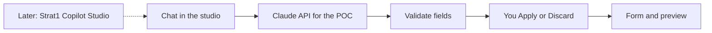

# OFT Template Maker — AI chat plan

## Product rule

The chat returns **field values only**. It never designs the email. Our templates in `src/templates/` still draw every pixel. You review a before/after list, then Apply or Discard. Manual editing stays.

## Current status

Built and in the app today:

- Three email masters with live preview
- Form editing, with images added through **Add image**
- Outputs: **Download .oft** (real Outlook template), **Download .eml** (draft), and **Copy for Outlook**
- Copilot agent in the left column, powered by Claude (propose changes, then Apply or Discard)
- Copilot Studio connection code ready when a tenant can publish

Blocked:

- University Copilot Studio environment cannot publish (billing / premium). No Token Endpoint to paste.

## POC approach (wired)

Claude API is the fill engine for the demo. The chat still looks like the in-tool Copilot panel. Claude answers in the background with the same JSON field contract. When Strat1 likes it, they point that same chat at their Copilot Studio agent.

Send posts to `/api/claude-fill` (a Vite dev route locally, a Vercel function when deployed) so `ANTHROPIC_API_KEY` stays on the server and is not shipped to the browser.

## Setup

1. Create an Anthropic API key at [platform.claude.com](https://platform.claude.com) → API keys.
2. Copy `.env.example` to `.env` in this project folder.
3. Paste the key into `.env` as `ANTHROPIC_API_KEY=...`. Do not commit `.env`.
4. Optional: set `ANTHROPIC_MODEL` (default is Claude Haiku 4.5).
5. Restart `npm run dev`.

## Copilot Studio path (later, Strat1 tenant)

When someone with premium Copilot Studio access can publish:

1. Create the agent and paste instructions from [copilot-studio-agent.md](copilot-studio-agent.md).
2. Publish → Channels → Mobile app → copy Token Endpoint.
3. Set `VITE_COPILOT_TOKEN_ENDPOINT` in `.env`.
4. Restart the studio. The chat label should say Copilot Studio connected.

A university ID is not expected to finish this step. That is fine for the POC.

## Out of scope for the POC

Pasting whole tables, extra languages, Teams sync, a production secret server.

## Repo

`.env` stays local and is ignored by git.
